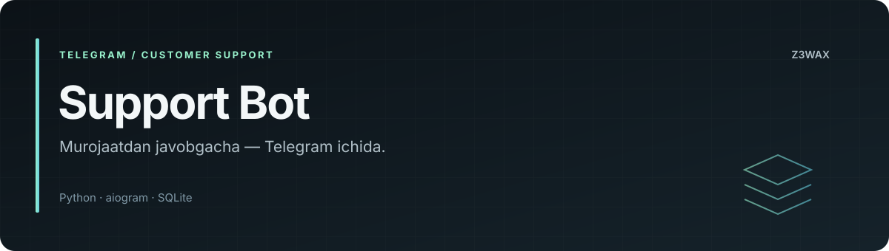

<!-- z3wax:presentation:start -->


[Loyiha xaritasi va misol](docs/PROJECT_GUIDE.md) · [Roadmap](ROADMAP.md) · [Baholash](docs/EVALUATION.md) · [Changelog](CHANGELOG.md) · [Relizlar](docs/RELEASING.md)

[](https://github.com/z3wax/aiogram3x-support-bot/actions/workflows/documentation.yml)

**Tekshiruvlar:** [Documentation workflow](https://github.com/z3wax/aiogram3x-support-bot/actions/workflows/documentation.yml)

Hujjatlar CI holati dastur yoki model testlari holatidan alohida.
<!-- z3wax:presentation:end -->

# Aiogram Support Bot

Telegram orqali mijoz murojaatlarini qabul qilish va operatorlar bilan suhbatni boshqarish uchun Python bot.

**Loyiha egasi:** [z3wax](https://github.com/z3wax)

## Imkoniyatlar

- Mijoz, operator va superadmin rollari.
- Ochiq murojaatlar, faol suhbatlar va arxiv.
- Operator reytingi, statistika va sevimli operatorlar.
- Tezkor javob shablonlari, xabar tarqatish va PDF hisobotlar.
- SQLite bilan asinxron ma'lumot saqlash.

## Tuzilma

| Fayl | Vazifasi |
|---|---|
| [bot/main.py](bot/main.py) | Telegram handlerlari, rollar va polling |
| [bot/database.py](bot/database.py) | Ma'lumotlar bazasi |
| [bot/requirements.txt](bot/requirements.txt) | Python bog'liqliklari |

## Lokal tayyorlash

Python virtual muhitida, repozitoriy ildizidan:

```bash
python -m venv .venv
source .venv/bin/activate
pip install -r bot/requirements.txt
cd bot
python main.py
```

Windows PowerShell uchun aktivlashtirish: `.venv\Scripts\Activate.ps1`.

**Ishga tushirishdan oldin:** `bot/main.py` dagi `TOKEN` hozir placeholder. Uni shaxsiy lokal nusxangizda sozlang va haqiqiy tokenni GitHub'ga yubormang. Kod `SUPERADMIN_ID` bilan bitta sonli foydalanuvchi ID'sini solishtiradi; joriy ro'yxat ko'rinishidagi placeholder superadminni aniqlashga mos emas. Ushbu sozlash talab qilinmaguncha admin oqimini tayyor deb hisoblamang.

## Tekshirish va cheklovlar

1. Alohida test botida `/start` yuboring.
2. Mijoz murojaati → operator qabul qilishi → javob → yopish oqimini sinang.
3. Reyting, arxiv va PDF eksportini tekshiring.
4. Qayta ishga tushirganda baza saqlanishini tekshiring.

Bog'liqliklarda versiya oralig'i keng: `ButtonStyle` kabi ishlatilgan API'lar o'rnatilgan aiogram versiyasida mavjudligini tekshiring. PDF eksporti matnni Latin-1 ga almashtiradi; barcha o'zbekcha belgilar bir xil chiqmasligi mumkin. Avtomatlashtirilgan testlar to'plami bu repozitoriyda ko'zda tutilmagan.

## Hissa qo'shish

[CONTRIBUTING.md](CONTRIBUTING.md) dagi tartibga amal qiling. Xatoni qayta chiqarish qadamlari, Python va aiogram versiyalarini ko'rsating.
