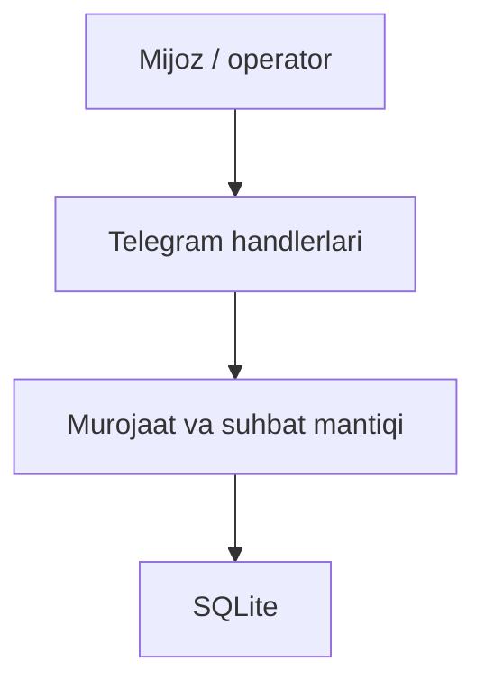

# Support Bot — loyiha xaritasi

[README](../README.md) · [Roadmap](../ROADMAP.md) · [Baholash](EVALUATION.md) · [Reliz tartibi](RELEASING.md)

## Maqsad

Murojaatdan javobgacha — Telegram ichida.

**Texnologiyalar:** Python · aiogram · SQLite.

## Arxitektura va oqim

Asosiy oqimning ixcham xaritasi; batafsil xulq manba kodida berilgan.



## Boshlang‘ich misol

Quyidagi buyruqlarni README dagi talablar va sozlash bosqichlaridan keyin, repozitoriy ildizidan bajaring:

```bash
cd bot
python main.py
```

Avval TOKEN va superadmin sozlamalarini lokal nusxada tayyorlang. README dagi SUPERADMIN_ID cheklovini hisobga oling; ushbu misol sozlanmagan holatda ishga tushmaydi.

Bu qo‘llanma misolni ushbu hujjat yangilanishi vaqtida bajarilgan test sifatida ko‘rsatmaydi. Test dalili, qurilma va natija baholash hisobotida alohida saqlanadi.

## Manba xaritasi

[bot/main.py](../bot/main.py) · [bot/database.py](../bot/database.py) · [bot/requirements.txt](../bot/requirements.txt)

## Ish jarayoni

1. Lokal yoki test muhitini tayyorlang.
2. Yuqoridagi eng kichik oqimni tekshiring.
3. Ta’sirlangan modulning testini bajaring.
4. Faqat haqiqiy natijalarni hisobotga kiriting.

[Hissa qo‘shish](../CONTRIBUTING.md) · [O‘zgarishlar](../CHANGELOG.md)
